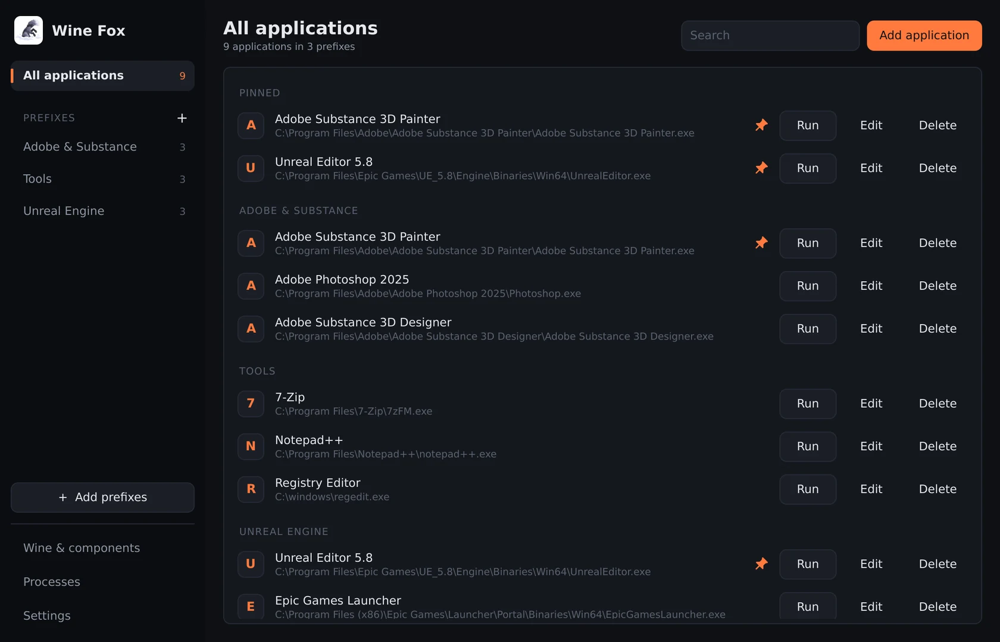
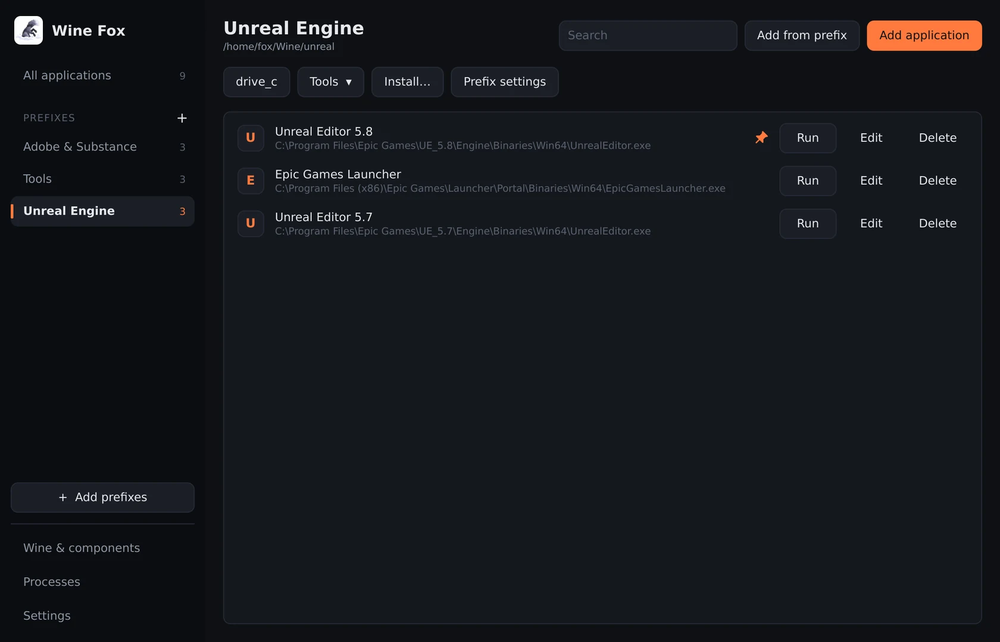
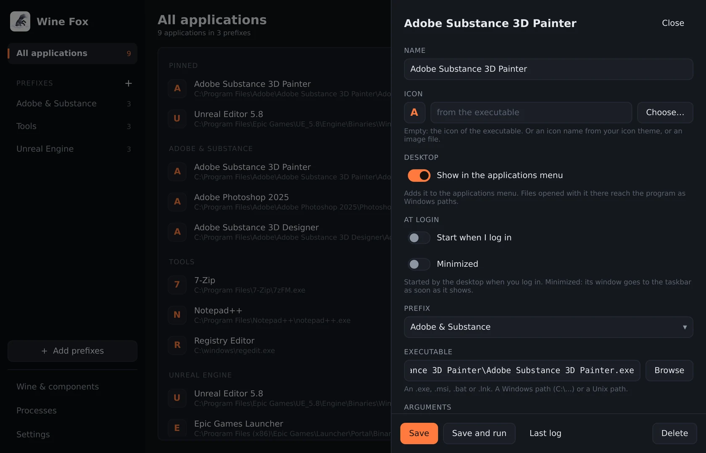
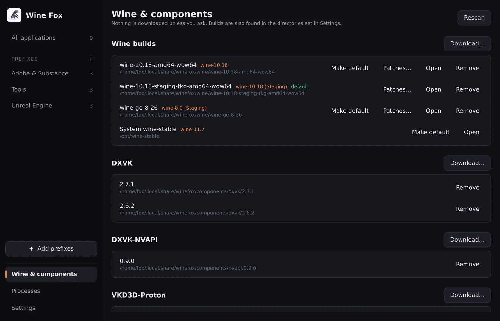
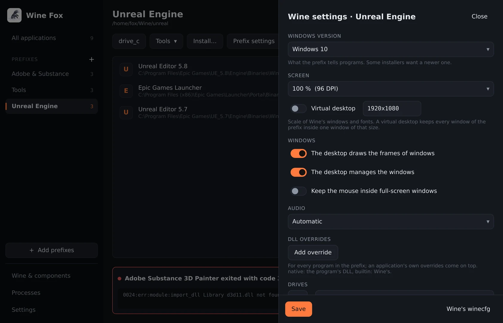
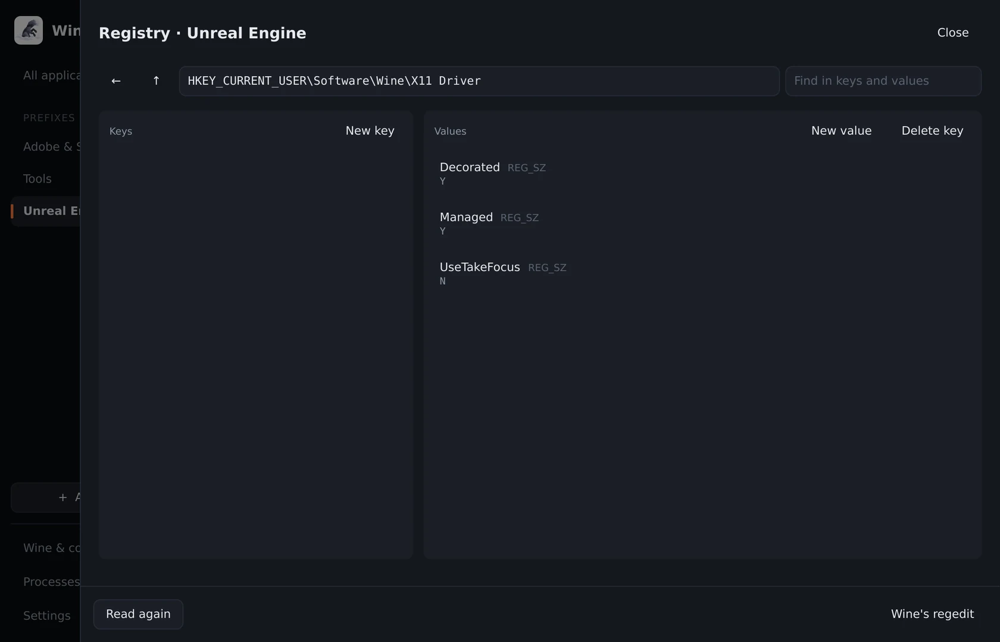
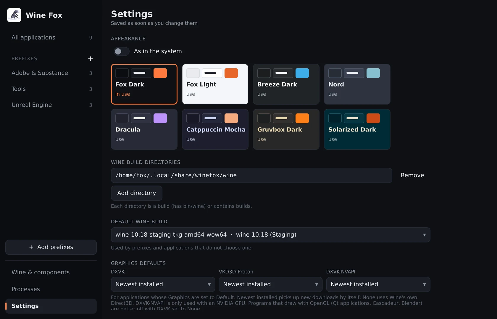
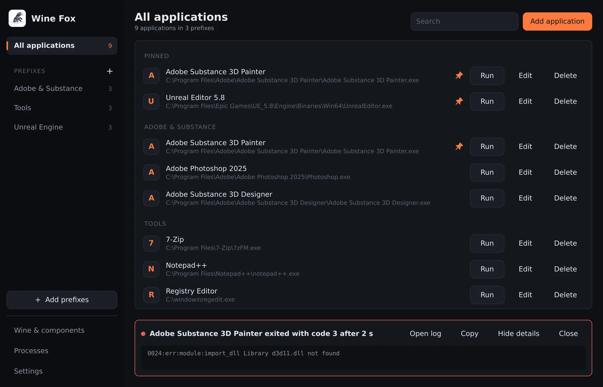
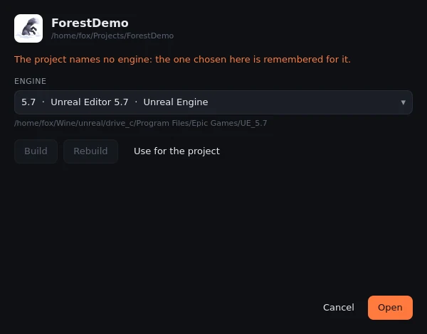
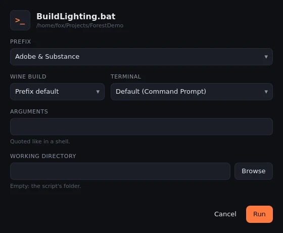

<p align="center"></p>

# Wine Fox

A Wine launcher for desktop software (not games): prefixes, the applications in them, Wine
builds and graphics components, processes, and tools — in one dark, minimal window.
Made for running big Windows tools like Unreal Engine under Wine on a Linux desktop (KDE first).

Python 3.12 + PySide6 (QML), shipped as an AppImage. [Русская версия](README.ru.md).

**[Download the AppImage](https://lis-carter.site/wine-fox/#download)** · [Website](https://lis-carter.site/wine-fox/) · [Docs (wiki)](https://lis-carter.site/wine-fox/docs.html) ·
[Installation guide](https://lis-carter.site/wine-fox/docs.html#install) · [Discord](https://discord.gg/uCd8DH9GVx) ·
[Wine-Fx](https://github.com/fly4xy/Wine-fx) (Wine with our patches)

<p align="center"></p>

## Screenshots

<table>
<tr><td align="center" width="50%"><br><sub>A prefix</sub></td><td align="center" width="50%"><br><sub>Application settings</sub></td></tr>
<tr><td align="center" width="50%"><br><sub>Wine & components</sub></td><td align="center" width="50%"><br><sub>Wine settings</sub></td></tr>
<tr><td align="center" width="50%"><br><sub>Registry editor</sub></td><td align="center" width="50%"><br><sub>Settings</sub></td></tr>
<tr><td align="center" width="50%"><br><sub>A launch problem, explained</sub></td><td align="center" width="50%"><br><sub>Opening a .uproject: engine, Build, Rebuild</sub></td></tr>
<tr><td align="center" width="50%"><br><sub>Running a .bat file</sub></td></tr>
</table>

## In this repository

| Folder | What |
|---|---|
| `winefox/` | the launcher |
| `packaging/` | the AppImage build, the Windows helpers |
| `scripts/` | the AutoSDK download and fonts, run by Wine Fox or by hand |
| `tools/` | the AutoSDK packer for Windows (`make-autosdk.ps1`), a window inspector for debugging (`wininspect.c`) |

Releases carry the AppImage. Wine-Fx, Wine with our patches, is a repository of its own
([Wine-fx](https://github.com/fly4xy/Wine-fx)): its patches, build script and file releases, which Wine Fox installs and updates.

## Running

```bash
chmod +x WineFox-0.9-x86_64.AppImage
./WineFox-0.9-x86_64.AppImage              # the window
./WineFox-0.9-x86_64.AppImage --help       # the command line
```

Only one Wine Fox runs at a time: starting it again shows the window that is already open.

## What it does

- **Prefixes and applications.** Add existing prefixes from a folder (nothing is started in
  them), create new ones, add programs from a prefix's *Add or remove programs* or pick an
  `.exe`. Every application has its own Wine build, DXVK / VKD3D-Proton / DXVK-NVAPI versions,
  DLL overrides, environment, sync mode, debug output, window frame and terminal.
- **Running.** A second click on a running application shows its window instead of starting a
  copy (a click on its row asks first). *Stop* asks its windows to close, as their close button
  does. Pinned applications come first in their prefix and under *Pinned* in All applications.
  Applications can start at login, minimized if wanted; Wine Fox itself can start in the tray.
  The tray menu (right click) lists the most used applications, with their icons (how many:
  Settings).
- **Launch problems.** Every run has a log with the build, prefix, components, command and the
  whole environment that differs from the session. A failed start shows the reason and offers
  *Retry with diagnostics* (detailed `WINEDEBUG`, crash backtrace).
- **Files from the file manager.** `.exe`, `.msi`, `.bat`, `.cmd` and `.uproject` open in Wine Fox:
  a file inside a prefix (or in a remembered folder) runs at once, otherwise a small window asks
  which prefix to use.
- **Scripts** (`.bat`, `.cmd`) run in cmd or PowerShell (installed into the prefix when needed),
  in the desktop's terminal (Konsole, GNOME Terminal, kitty, Alacritty, WezTerm, foot, Tabby, …)
  with colours and emoji, or in Wine's own console window.
- **Unreal Engine projects.** Opening a `.uproject` lets you choose the engine (any application
  that is an `UnrealEditor.exe` without a project in its arguments), open the project, build or
  rebuild its editor target (the project files are generated first), or write the engine into
  the project's `EngineAssociation`.
  Before any program of a prefix with an engine starts (the editor, a build, UnrealGameSync), the prefix gets the root certificates NuGet trusts (from
  the engine's .NET SDK) that Linux CA lists no longer have: without them UnrealBuildTool's
  restore fails on older packages with NU3018 / NU3028 / NU3037.
- **Unreal C++ in a Linux code editor** (Settings, Code editor). Build and Open of a project
  (and the build window's *VS Code files* box) also turn its VS Code files into a Linux workspace, `compile_commands.json` for clangd and
  `c_cpp_properties.json`: Unix paths, the build's own flags and language standard, the MSVC
  library and Windows SDK from the AutoSDK, their headers found whatever the case of their names.
  Code completion and highlighting in VS Code with clangd (also VSCodium, CLion, Zed, Kate);
  Live Coding stays in Unreal. The editor plugin in [`WineFoxVSCode`](https://github.com/fly4xy/Wine-fx/tree/main/unreal/WineFoxVSCode) (in the Wine-Fx repository)
  opens a Blueprint's C++ class or the project from Unreal in that VS Code.
- **"Open file location" in the Linux file manager.** *Show in folder*, *Open file location* and
  folders opened by Windows programs show up in Dolphin, Nautilus and the like (the file
  selected), not in Wine's explorer; Wine's desktop and the rest stay Wine's (Settings, Desktop
  integration).
- **Wine builds and components** from GitHub releases on request: Kron4ek (Wine, WoW64, Staging,
  Staging TkG), Wine-GE, Lutris Wine, DXVK, VKD3D-Proton, DXVK-NVAPI. Stable DXVK, VKD3D-Proton
  and DXVK-NVAPI come inside the AppImage.
- **Tools in Wine Fox's style:** Wine settings, Installed programs (with Modify and Uninstall),
  Registry editor, Processes, Command line (also as administrator). Wine's own windows
  are a switch away in Settings.
- **Processes** by prefix, including ones Wine Fox did not start: CPU, memory, threads and disk
  for every process, sorted by any column, and a *Performance* tab with the prefix's last two
  minutes.
- **Wine-Fx builds** (the Wine-Fx repository) carry Wine Fox's fixes to Wine itself; Wine Fox downloads and updates them (Wine & components).
- **Patches for prefixes**: fixes to Wine's Windows modules (system file dialogs, dragging files in, .bat scripts, the Epic Games Launcher crash) come with Wine Fox (in the AppImage) and go into one prefix (Tools, Patches), leaving the build as it is.
- **Recipes** for prefixes (TOML): Unreal Engine AutoSDK layout, Windows fonts, Visual Studio
  telemetry off; winetricks verbs.
- **Desktop integration:** applications in the menu (with their icon and window class), Wine Fox
  in the menu, the tray, file handlers, Wine Fox's colours in Wine's windows and menus.
- **Lutris import** of games and programs with their settings.
- **Scrolling** at the desktop's speed, or faster (Settings).
- **English or Russian**, as the system is set or chosen in Settings.
- **AutoSDK for Unreal Engine** (Wine & components): MSVC and the Windows SDK downloaded from
  Microsoft into a folder you choose, and into a prefix, after you accept their license.
- **Repairs before every run:** the `users` folder (shared with another prefix or linked to
  your folders) and DLLs that link to files that are gone (left by other launchers).

## Unreal Editor plugin

[`WineFoxVSCode`](https://github.com/fly4xy/Wine-fx/tree/main/unreal/WineFoxVSCode), in the Wine-Fx repository, adds *Tools → Open in VS Code (Linux)*
to Unreal Editor running in Wine; Wine Fox tells it which VS Code to start (`WINEFOX_CODE`).

## Scripts

Windows parts Wine Fox does not carry, fetched on your computer from their makers:

```bash
scripts/fetch-autosdk.sh --accept-license --prefix ~/Games/ue --engine ~/Games/ue/drive_c/UE_5.8
scripts/install-fonts.sh --prefix ~/Games/ue [--corefonts --accept-eula]
```

- `fetch-autosdk.sh`: MSVC and the Windows SDK from Microsoft's servers (with
  [msvc-wine](https://github.com/mstorsjo/msvc-wine)'s downloader), laid out as an AutoSDK, put into
  the prefix as `C:\AutoSDK` with `UE_SDKS_ROOT` set and the compiler's telemetry
  (`vctip.exe`, which hangs under Wine) removed; `--archive` also packs it for
  Wine Fox's AutoSDK recipe. You accept Microsoft's licenses with `--accept-license`. The .NET
  Framework SDK is not part of that download: the script says how to add it.
- `install-fonts.sh`: free fonts with the metrics of Microsoft's (Carlito for Calibri, Caladea for
  Cambria, Selawik for Segoe UI, Liberation for Arial, Times New Roman and Courier New) set as
  their stand-ins when this computer has them; `--corefonts` also downloads Microsoft's *Core fonts
  for the Web* from their original packages.

## Command line

```text
winefox run <app> [--minimized] [-- args]   run an application; file arguments become Windows paths
winefox open <file> [--prefix P]   run an .exe/.msi/.bat (the prefix is found from the path)
winefox list apps|prefixes|builds
winefox ps                         Wine processes by prefix
winefox kill <prefix> | --all      wineserver -k, then SIGKILL what is left
winefox prefix create <name> [--path P] [--build B]
winefox prefix import <folder>     add the prefixes in a folder, starting nothing in them
winefox app add <name> --prefix P --exe E [--args A]
winefox app scan <prefix> [--add]  the programs of the prefix's Add or remove programs
winefox download sources|list <source>|get <source> [version]
winefox components                 installed DXVK / VKD3D-Proton / DXVK-NVAPI
winefox recipe list | run <prefix> <recipe> key=value
winefox winetricks <prefix> <verb...> | --download | --list
winefox import-lutris [names] [--list]
winefox logs                       where the logs are
winefox --tray                     start in the tray, without the window
winefox <file.exe>                 as from the file manager
```

In an application's arguments `{args}` marks where the arguments of a launch go (such as `%F`
from its menu entry); without it they are added at the end.

## Files

| What | Where |
|---|---|
| settings, prefixes, applications (TOML, a file each) | `~/.config/winefox/` |
| new prefixes, downloaded builds and components | `~/.local/share/winefox/` |
| Wine Fox's log (detailed: a switch in Settings) | `~/.local/state/winefox/logs/winefox.log` |
| the output of every run (the last 20 per application) | `~/.local/state/winefox/logs/runs/` |
| extracted icons | `~/.cache/winefox/icons/` |
| menu entries, autostart entries | `~/.local/share/applications/winefox-*.desktop`, `~/.config/autostart/winefox-*.desktop` |
| per-prefix state (components, colours, explorer) | `<prefix>/.winefox/` |

## Development

```bash
python3 -m venv ~/wf-venv && ~/wf-venv/bin/pip install PySide6-Essentials tomli-w zstandard certifi
~/wf-venv/bin/python -m winefox
WINEFOX_SCREENSHOTS=/tmp/shots QT_QPA_PLATFORM=offscreen ~/wf-venv/bin/python -m winefox   # PNGs of the pages
bash packaging/build-appimage.sh      # dist/WineFox-<version>-x86_64.AppImage
```

The Windows helpers (`packaging/helpers`: the
administrator command line, explorer.exe for the Linux file manager) need mingw-w64. All styling lives in `winefox/gui/qml/Theme.qml`.

| Module | What |
|---|---|
| `cli.py`, `gui/app.py`, `gui/backend.py`, `gui/qml/` | command line, window, the bridge between them |
| `config.py` | settings, prefixes, applications (TOML) |
| `launch.py`, `servers.py`, `focus.py` | starting programs, terminals, Wine processes, X11 windows |
| `wine.py`, `components.py` | Wine builds; DXVK / VKD3D-Proton / DXVK-NVAPI and downloads |
| `discover.py`, `icons.py`, `desktop.py`, `lutris.py` | installed programs, icons, menu and autostart entries, Lutris |
| `unreal.py`, `ide.py` | `.uproject`: engines, open, build, EngineAssociation; VS Code files for Linux |
| `nugetroots.py` | NuGet's root certificates in prefixes of Unreal Engine |
| `filemanager.py`, `packaging/helpers/` | explorer.exe that opens places in the Linux file manager; elevate.exe |
| `usage.py` | how often applications run (the tray menu) |
| `autosdk.py`, `scripts/` | the AutoSDK download (fetch-autosdk.sh) and fonts (install-fonts.sh) |
| `i18n.py`, `i18n/<language>/*.json` | the interface's language: texts by their English source |
| `recipes.py` | recipes and winetricks |
| `wineconf.py`, `registry.py`, `wincolors.py`, `users.py` | Wine settings, registry editor, colours, the users folder |

## License

Wine Fox: GPL-3.0, see [LICENSE](LICENSE). The patches to Wine and the files of Wine they change
(Wine-Fx's in its repository; those of the patch pack for prefixes come with the AppImage, `opt/patches/*/source`): LGPL-2.1-or-later, like Wine. Epic Games' patches
(in the Wine-Fx repository, `versions/*/epic`): MIT, see the `LICENSE` next to them. Microsoft's toolchain, SDKs and
fonts are not in this repository: the scripts download them on your computer after you accept
Microsoft's licenses.
