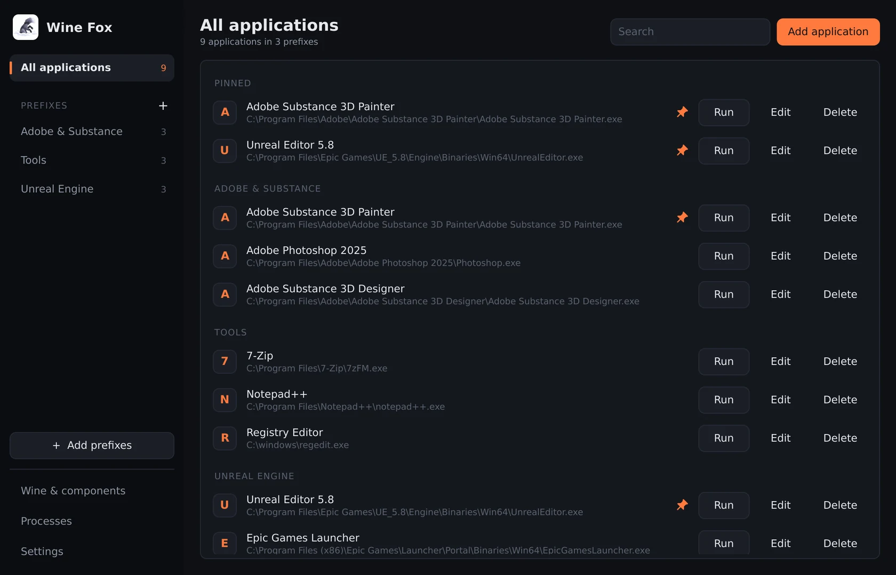
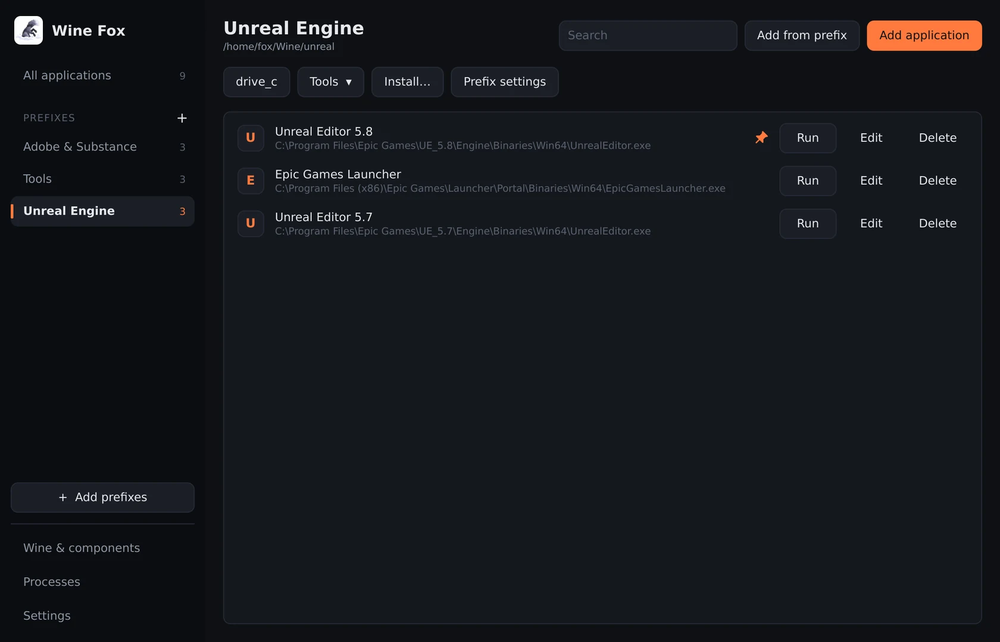
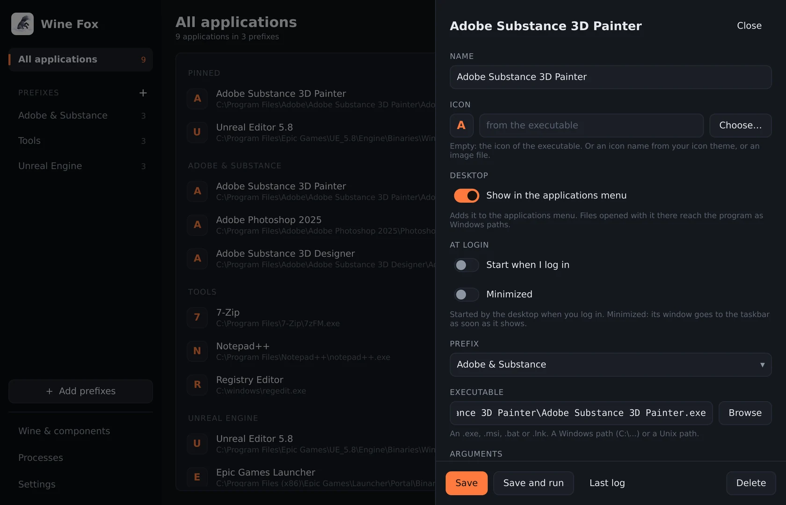
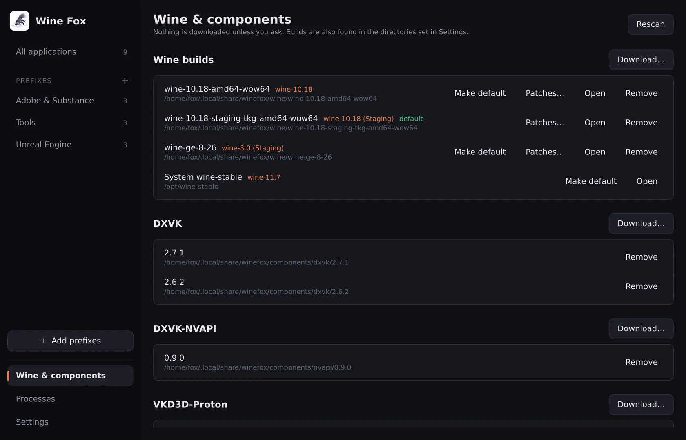
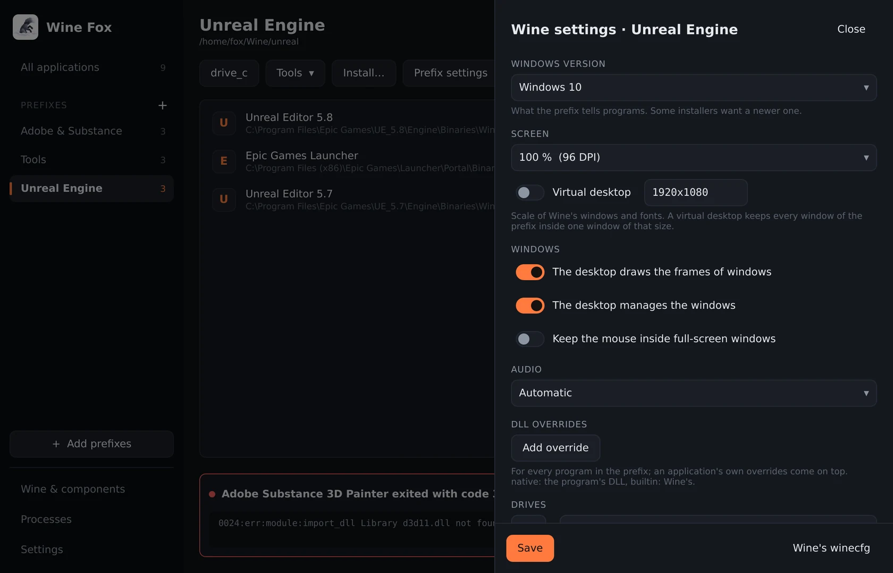
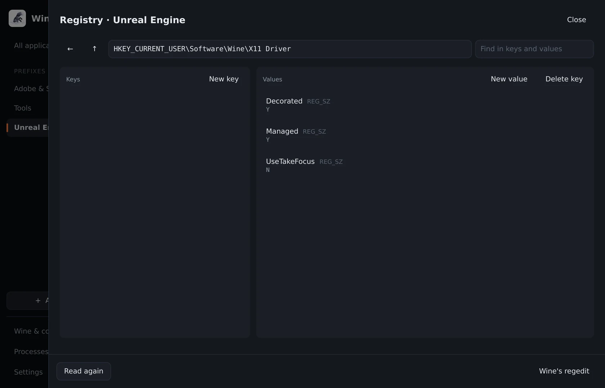
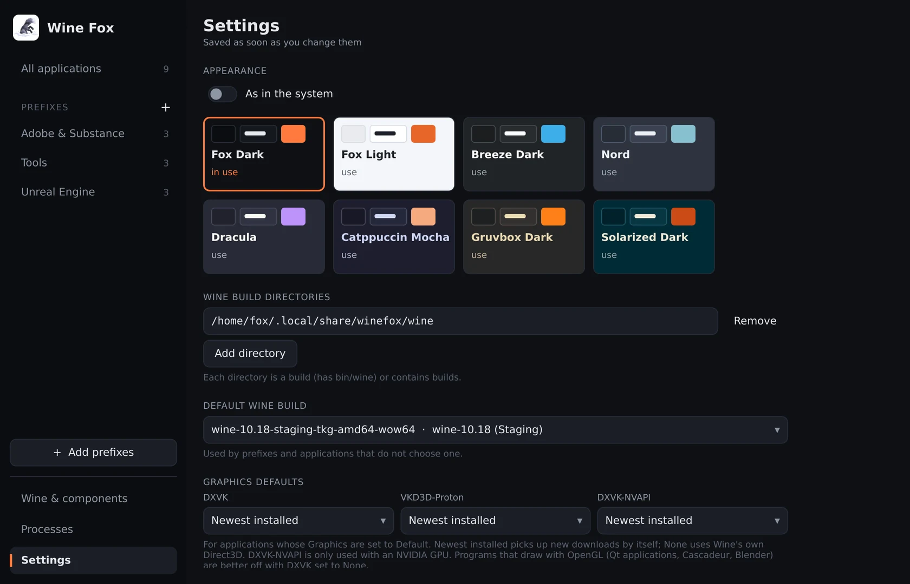
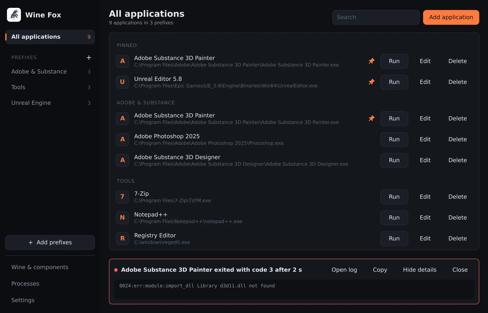
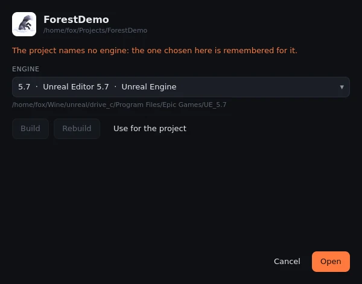
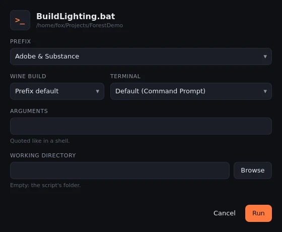

<p align="center"></p>

# Wine Fox

Лаунчер Wine для программ (не игр): префиксы, приложения в них, сборки Wine и графические
компоненты, процессы и инструменты — в одном тёмном минималистичном окне. Сделан для запуска
больших Windows-инструментов вроде Unreal Engine под Wine на Linux (в первую очередь KDE).

Python 3.12 + PySide6 (QML), распространяется как AppImage. [English version](README.md).

**[Скачать AppImage](https://lis-carter.site/wine-fox/#download)** · [Сайт](https://lis-carter.site/wine-fox/) · [Вики](https://lis-carter.site/wine-fox/docs.html) ·
[Как установить](https://lis-carter.site/wine-fox/docs.html#install) · [Discord](https://discord.gg/uCd8DH9GVx) ·
[Wine-Fx](https://github.com/fly4xy/Wine-fx) (Wine с нашими патчами)

<p align="center"></p>

## Скриншоты

<table>
<tr><td align="center" width="50%"><br><sub>Префикс</sub></td><td align="center" width="50%"><br><sub>Настройки приложения</sub></td></tr>
<tr><td align="center" width="50%"><br><sub>Wine и компоненты</sub></td><td align="center" width="50%"><br><sub>Настройки Wine</sub></td></tr>
<tr><td align="center" width="50%"><br><sub>Редактор реестра</sub></td><td align="center" width="50%"><br><sub>Настройки</sub></td></tr>
<tr><td align="center" width="50%"><br><sub>Ошибка запуска с объяснением</sub></td><td align="center" width="50%"><br><sub>Открытие .uproject: движок, Build, Rebuild</sub></td></tr>
<tr><td align="center" width="50%"><br><sub>Запуск .bat-файла</sub></td></tr>
</table>

## Что в репозитории

| Папка | Что |
|---|---|
| `winefox/` | сам лаунчер |
| `packaging/` | сборка AppImage, Windows-помощники |
| `scripts/` | загрузка AutoSDK и шрифты: их запускает Wine Fox или вы сами |
| `tools/` | упаковщик AutoSDK для Windows (`make-autosdk.ps1`), инспектор окон для отладки (`wininspect.c`) |

В релизах лежит AppImage. Wine-Fx, Wine с нашими патчами, теперь отдельный репозиторий
([Wine-fx](https://github.com/fly4xy/Wine-fx)): его патчи, скрипт сборки и файловые релизы, которые Wine Fox ставит и обновляет.

## Запуск

```bash
chmod +x WineFox-0.9-x86_64.AppImage
./WineFox-0.9-x86_64.AppImage              # окно
./WineFox-0.9-x86_64.AppImage --help       # командная строка
```

Wine Fox работает в одном экземпляре: повторный запуск показывает уже открытое окно.

## Что умеет

- **Префиксы и приложения.** Добавление существующих префиксов из папки (в них ничего не
  запускается), создание новых, добавление программ из «Установки и удаления программ» префикса
  или выбором `.exe`. У каждого приложения своя сборка Wine, версии DXVK / VKD3D-Proton /
  DXVK-NVAPI, DLL overrides, окружение, синхронизация, вывод отладки, рамка окна и терминал.
- **Gamescope.** Приложения можно запускать внутри gamescope от Valve (своё разрешение,
  масштабирование FSR, ограничение кадров, HDR) с его параметрами: в Настройках для всех, для
  префикса или для отдельного приложения. По умолчанию выключено; без установленного gamescope
  программы запускаются как обычно. Так же включаются MangoHud (оверлей FPS) и GameMode.
- **Видеокарта.** Если видеокарт несколько, префикс или приложение запускаются на выбранной
  (PRIME и выбор устройства Mesa, render offload NVIDIA: за ней идут OpenGL, Vulkan, DXVK и VKD3D).
- **Игры.** Время в каждом приложении; сетка обложек вместо списка (любая картинка, у игр из
  Steam — его собственная); приложения в библиотеке Steam как сторонние игры (Big Picture,
  игровой режим Steam Deck).
- **Проверка префикса.** Что мешает ему работать (приложения без exe, диски без папки, DLL со
  ссылками на удалённые файлы, Edge Update, не дающий префиксу остановиться, другая версия Wine,
  нет основных шрифтов или Visual C++), у каждого пункта своё исправление, или всё сразу.
- **Сохранение и восстановление префикса** вместе с приложениями одним архивом (zstd или gzip):
  резервная копия или перенос на другой компьютер.
- **Запуск.** Повторный клик по запущенному приложению показывает его окно, а не запускает копию
  (клик по строке сначала спрашивает). *Stop* просит окна программы закрыться, как их крестик.
  Закреплённые приложения стоят первыми в префиксе и в группе *Pinned* во «Всех приложениях».
  Приложения могут запускаться при входе в систему, при желании свёрнутыми; сам Wine Fox — в трее.
  В меню трея (правый клик) — самые часто запускаемые приложения с иконками (сколько — в Settings).
- **Ошибки запуска.** У каждого запуска есть лог: сборка, префикс, компоненты, команда и всё
  окружение, отличное от сессии. Неудачный запуск показывает причину и кнопку *Retry with
  diagnostics* (подробный `WINEDEBUG`, бэктрейс падения).
- **Файлы из файлового менеджера.** `.exe`, `.msi`, `.bat`, `.cmd` и `.uproject` открываются в
  Wine Fox: файл внутри префикса (или в запомненной папке) запускается сразу, иначе маленькое
  окно спрашивает, какой префикс взять.
- **Скрипты** (`.bat`, `.cmd`) выполняются в cmd или PowerShell (он ставится в префикс при
  необходимости) — в терминале рабочего стола (Konsole, GNOME Terminal, kitty, Alacritty,
  WezTerm, foot, Tabby, …) с цветами и эмодзи или в консоли самого Wine.
- **Проекты Unreal Engine.** При открытии `.uproject` можно выбрать движок (любое приложение
  `UnrealEditor.exe` без проекта в аргументах), открыть проект, собрать или пересобрать его
  editor-таргет (сначала генерируются файлы проекта) или записать движок в `EngineAssociation`.
  Перед запуском любой программы в префиксе с движком (редактор, сборка, UnrealGameSync) в префикс один раз добавляются корневые сертификаты, которым доверяет
  NuGet (из .NET SDK движка) и которых уже нет в списках Linux: без них restore в UnrealBuildTool
  падает на старых пакетах с NU3018 / NU3028 / NU3037.
- **C++ Unreal в редакторе кода на Linux** (Settings, Code editor). Build и Open проекта (и галочка
  *VS Code files* в окне сборки) заодно превращают его файлы для VS Code в линуксовый workspace, `compile_commands.json` для clangd и
  `c_cpp_properties.json`: Unix-пути, флаги и стандарт языка самой сборки, библиотека MSVC и
  Windows SDK из AutoSDK, их заголовки находятся в любом регистре. Подсказки и подсветка в
  VS Code с clangd (а также VSCodium, CLion, Zed, Kate); Live Coding — в Unreal. Плагин редактора
  из [`WineFoxVSCode`](https://github.com/fly4xy/Wine-fx/tree/main/unreal/WineFoxVSCode) (в репозитории Wine-Fx) открывает в этом VS Code C++-класс блупринта или проект.
- **«Открыть расположение файла» в файловом менеджере Linux.** *Show in folder*, *Open file
  location* и папки, которые открывают Windows-программы, показываются в Dolphin, Nautilus и т. п.
  (с выделенным файлом), а не в проводнике Wine; рабочий стол Wine и остальное остаются за Wine
  (Settings, Desktop integration).
- **Сборки Wine и компоненты** с релизов GitHub по запросу: Kron4ek (Wine, WoW64, Staging,
  Staging TkG), Wine-GE, Lutris Wine, DXVK, VKD3D-Proton, DXVK-NVAPI. Стабильные DXVK,
  VKD3D-Proton и DXVK-NVAPI лежат внутри AppImage.
- **Инструменты в стиле Wine Fox:** настройки Wine, установленные программы (с Modify и
  Uninstall), редактор реестра, процессы, командная строка (в том числе от администратора).
  Родные окна Wine включаются переключателем в Settings.
- **Процессы** по префиксам, в том числе запущенные не из Wine Fox: CPU, память, потоки и диск у
  каждого процесса, сортировка по любой колонке и вкладка *Performance* с последними двумя
  минутами префикса.
- **Сборки Wine-Fx** (репозиторий Wine-Fx) несут исправления Wine Fox в самом Wine; Wine Fox скачивает и обновляет их («Wine и компоненты»).
- **Патчи для префиксов**: исправления Windows-модулей Wine (системные диалоги файлов, перетаскивание файлов, .bat-скрипты, вылет Epic Games Launcher) идут в самом Wine Fox (внутри AppImage) и ставятся в один префикс (Инструменты, Патчи), не трогая сборку.
- **Рецепты** для префиксов (TOML): раскладка AutoSDK для Unreal Engine, шрифты Windows,
  отключение телеметрии Visual Studio; команды winetricks.
- **Интеграция с рабочим столом:** приложения в меню (со своей иконкой и классом окна), Wine Fox
  в меню, трей, обработчики файлов, цвета Wine Fox в окнах и меню Wine.
- **Импорт** из Lutris (игры и программы с их настройками), Heroic (Epic, GOG, добавленные
  вручную), Bottles (каждая бутылка — префикс, с её программами) и Steam (префиксы Proton; exe
  угадывается).
- **Прокрутка** со скоростью рабочего стола или быстрее (Settings).
- **Английский или русский** — как в системе или по выбору в Settings.
- **AutoSDK для Unreal Engine** (Wine & components): MSVC и Windows SDK скачиваются с серверов
  Microsoft в выбранную папку и в префикс, после принятия их лицензии.
- **Починка перед каждым запуском:** папка `users` (общая с другим префиксом или со ссылками на
  ваши папки) и DLL, ссылающиеся на удалённые файлы (остатки других лаунчеров).

## Плагин Unreal Editor

[`WineFoxVSCode`](https://github.com/fly4xy/Wine-fx/tree/main/unreal/WineFoxVSCode) из репозитория Wine-Fx добавляет в Unreal Editor под Wine пункт
*Tools → Open in VS Code (Linux)*; какой VS Code запускать, ему сообщает Wine Fox (`WINEFOX_CODE`).

## Скрипты

Windows-части, которых нет в Wine Fox, — скачиваются на вашем компьютере у их авторов:

```bash
scripts/fetch-autosdk.sh --accept-license --prefix ~/Games/ue --engine ~/Games/ue/drive_c/UE_5.8
scripts/install-fonts.sh --prefix ~/Games/ue [--corefonts --accept-eula]
```

- `fetch-autosdk.sh`: MSVC и Windows SDK с серверов Microsoft (загрузчиком
  [msvc-wine](https://github.com/mstorsjo/msvc-wine)), разложенные как AutoSDK, ставятся в префикс
  как `C:\AutoSDK` с `UE_SDKS_ROOT` и без телеметрии компилятора
  (`vctip.exe` под Wine зависает); `--archive` ещё и пакует их для рецепта AutoSDK в Wine Fox.
  Лицензии Microsoft вы принимаете флагом `--accept-license`. .NET Framework SDK в эту загрузку не
  входит — скрипт подскажет, как его добавить.
- `install-fonts.sh`: свободные шрифты с метриками шрифтов Microsoft (Carlito вместо Calibri,
  Caladea вместо Cambria, Selawik вместо Segoe UI, Liberation вместо Arial, Times New Roman и
  Courier New) прописываются заменой, если они есть на компьютере; `--corefonts` ещё и скачивает
  *Core fonts for the Web* Microsoft из их оригинальных пакетов.

## Командная строка

```text
winefox run <app> [--minimized] [-- args]   запустить приложение; файлы-аргументы передаются как Windows-пути
winefox open <file> [--prefix P]   запустить .exe/.msi/.bat (префикс определяется по пути)
winefox list apps|prefixes|builds
winefox ps                         процессы Wine по префиксам
winefox kill <prefix> | --all      wineserver -k, затем SIGKILL того, что осталось
winefox prefix create <name> [--path P] [--build B]
winefox prefix import <folder>     добавить префиксы из папки, ничего в них не запуская
winefox app add <name> --prefix P --exe E [--args A]
winefox app scan <prefix> [--add]  программы из «Установки и удаления программ» префикса
winefox download sources|list <source>|get <source> [version]
winefox components                 установленные DXVK / VKD3D-Proton / DXVK-NVAPI
winefox recipe list | run <prefix> <recipe> key=value
winefox winetricks <prefix> <verb...> | --download | --list
winefox import-lutris [names] [--list]
winefox logs                       где лежат логи
winefox --tray                     запуск в трее, без окна
winefox <file.exe>                 как из файлового менеджера
```

В аргументах приложения `{args}` отмечает место для аргументов запуска (например `%F` из его
пункта меню); без него они добавляются в конец.

## Файлы

| Что | Где |
|---|---|
| настройки, префиксы, приложения (TOML, по файлу на объект) | `~/.config/winefox/` |
| новые префиксы, скачанные сборки и компоненты | `~/.local/share/winefox/` |
| лог Wine Fox (подробный — переключатель в Settings) | `~/.local/state/winefox/logs/winefox.log` |
| вывод каждого запуска (20 последних на приложение) | `~/.local/state/winefox/logs/runs/` |
| извлечённые иконки | `~/.cache/winefox/icons/` |
| пункты меню и автозапуска | `~/.local/share/applications/winefox-*.desktop`, `~/.config/autostart/winefox-*.desktop` |
| состояние префикса (компоненты, цвета, проводник) | `<префикс>/.winefox/` |

## Разработка

```bash
python3 -m venv ~/wf-venv && ~/wf-venv/bin/pip install PySide6-Essentials tomli-w zstandard certifi
~/wf-venv/bin/python -m winefox
WINEFOX_SCREENSHOTS=/tmp/shots QT_QPA_PLATFORM=offscreen ~/wf-venv/bin/python -m winefox   # PNG страниц
bash packaging/build-appimage.sh      # dist/WineFox-<версия>-x86_64.AppImage
```

Windows-помощникам (`packaging/helpers`: командная
строка от администратора, explorer.exe для файлового менеджера Linux) нужен mingw-w64. Оформление целиком задаётся в
`winefox/gui/qml/Theme.qml`.

| Модуль | Что делает |
|---|---|
| `cli.py`, `gui/app.py`, `gui/backend.py`, `gui/qml/` | командная строка, окно и связка между ними |
| `config.py` | настройки, префиксы, приложения (TOML) |
| `launch.py`, `servers.py`, `focus.py` | запуск программ, терминалы, процессы Wine, окна X11 |
| `wine.py`, `components.py` | сборки Wine; DXVK / VKD3D-Proton / DXVK-NVAPI и загрузки |
| `discover.py`, `icons.py`, `desktop.py`, `lutris.py` | установленные программы, иконки, пункты меню и автозапуска, Lutris |
| `unreal.py`, `ide.py` | `.uproject`: движки, открытие, сборка, EngineAssociation; файлы VS Code для Linux |
| `nugetroots.py` | корневые сертификаты NuGet в префиксах Unreal Engine |
| `filemanager.py`, `packaging/helpers/` | explorer.exe, открывающий места в файловом менеджере Linux; elevate.exe |
| `usage.py` | как часто запускаются приложения (меню трея) |
| `autosdk.py`, `scripts/` | загрузка AutoSDK (fetch-autosdk.sh) и шрифты (install-fonts.sh) |
| `i18n.py`, `i18n/<язык>/*.json` | язык интерфейса: тексты по их английскому оригиналу |
| `recipes.py` | рецепты и winetricks |
| `wineconf.py`, `registry.py`, `wincolors.py`, `users.py` | настройки Wine, редактор реестра, цвета, папка users |

## Лицензия

Wine Fox: GPL-3.0, см. [LICENSE](LICENSE). Патчи к Wine и изменённые ими файлы Wine
(патчи Wine-Fx в его репозитории; патчи набора для префиксов лежат в AppImage, `opt/patches/*/source`): LGPL-2.1-or-later, как сам Wine. Патчи Epic Games
(в репозитории Wine-Fx, `versions/*/epic`): MIT, см. `LICENSE` рядом с ними. Тулчейна, SDK и шрифтов Microsoft
в репозитории нет: скрипты скачивают их у вас на компьютере после того, как вы примете лицензии
Microsoft.
